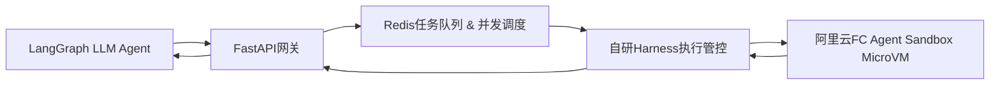

# 项目新定位
项目名称：**面向LLM Agent的代码解释器网关服务（基于阿里云FC Agent Sandbox）**
核心一句话：
> 底层隔离依赖阿里云FC Agent Sandbox（MicroVM轻量虚拟机，高安全隔离），自研 **Harness执行管控层 + 任务调度层 + 标准化工具网关**，封装成OpenAI兼容工具接口，供LangGraph Agent调用，安全执行不可信Python代码、绘图、返回结果。

> 重点区分（面试必背）
> 阿里云负责：MicroVM隔离、CPU/内存配额、网络策略、底层资源销毁；
> 你自研：Harness生命周期管控、双层超时熔断、输出截断、产物（图片）回流、任务排队限流、前置AST校验、统一对外工具协议。
> 安全策略：**一任务一沙箱，执行完强制销毁，业务层禁止复用沙箱上下文**

✅ 优势：不用折腾Docker、seccomp、cgroup、容器逃逸；能聚焦在**工程编排、异常兜底、调度、工具协议**，工业界Agent沙箱主流方案；
⚠️ 短板：底层隔离不是你写的，面试重点不再是容器内核，转向：Harness设计、可靠性、异常兜底、成本控制、并发调度。

## 技术栈
- Python 3.10+
- FastAPI：网关服务
- 阿里云SDK：`aliyun-python-sdk-fc` / FC Agent Sandbox 官方SDK
- Redis：任务队列、限流、并发控制
- Pydantic：请求响应模型
- LangGraph：Agent调用Demo
- 可选：Locust 压测

## 仓库目录（更新版）
```
code-sandbox-gateway/
├── app/
│   ├── main.py          # FastAPI网关，对外 /tools/code_interpreter
│   ├── schemas.py       # 请求、响应结构体
│   ├── harness.py       # 核心自研Harness：管理阿里云沙箱生命周期
│   ├── sandbox_client.py # 阿里云FC沙箱SDK封装（创建、执行、拉文件、销毁）
│   ├── scheduler.py     # Redis任务队列、并发限流、调度
│   └── security.py      # AST静态扫描、参数校验、高危关键词过滤
├── agent_demo/
│   └── langgraph_demo.py # LangGraph调用这个工具的示例
├── test_cases/          # 测试用例：死循环、大量输出、绘图、恶意代码
├── .env                 # 阿里云ak/sk、地域、账号配置（gitignore）
├── requirements.txt
└── README.md
```

## 整体周期规划（业余时间，每天2～3h，总时长7～10天）
> 优先级：先跑通最小闭环 → 可靠性加固 → 调度优化 → Agent对接 → 测试&文档
> 不做花里胡哨功能，所有模块都服务面试讲故事

---
## 阶段0：前置准备（0.5天）
1. 开通阿里云FC，开启 **Agent Sandbox（函数计算沙箱）**，拿到 AK/SK、地域、账号信息
2. 本地环境：Redis、Python、安装依赖
3. 新建仓库，建好目录，配置 `.gitignore`（不要提交ak/sk）
4. 先跑通阿里云官方SDK Demo：手动创建沙箱、执行一段Python代码、下载生成图片、销毁沙箱
> 验收：你本地可以单独调用阿里云沙箱跑代码，理解4个基础动作：`create → run_code → download_file → delete`

## 阶段1：最小可用版本（1～2天，核心闭环）
目标：curl调用接口，提交代码，Harness调用阿里云沙箱执行，返回stdout/stderr、图片、退出码，执行完毕自动销毁沙箱
开发顺序：
1. `schemas.py`：定义入参（code、timeout、max_memory_mb）、出参（stdout、stderr、images、exit_code、duration、oom、timeout_flag）
2. `sandbox_client.py`：对阿里云SDK做一层薄封装，只封装4个基础方法
    - create_sandbox
    - run_code
    - download_file
    - delete_sandbox
3. `harness.py`（本项目**核心**）
    - 调用上面的sandbox_client
    - **双层超时**：业务层看门狗（你的代码） + 阿里云沙箱自带超时，兜底防止SDK卡死、沙箱泄漏、持续计费
    - 输出截断：限制stdout/stderr最大长度，防御输出炸弹
    - 收集日志、下载matplotlib图片
    - finally 块强制销毁沙箱（无论成功、报错、超时，必须销毁，面试重点）
    - 统计耗时、标记是否超时
4. `main.py`：FastAPI，暴露 POST `/tools/code_interpreter`
5. 本地 curl 测试
    ✅ 正向用例：简单计算、matplotlib绘图
    ✅ 边界用例：死循环，验证看门狗超时熔断 + 沙箱销毁
> 本阶段**暂时不做队列、限流、AST扫描**，先打通链路

交付物：独立HTTP服务，curl即可跑代码，单次任务自动销毁沙箱。

## 阶段2：安全与可靠性加固（2天，面试重点加分模块）
1. `security.py` 前置防护
    - AST语法树解析，简单拦截高危行为（导入os、subprocess等，**一定要在文档说明：仅前置防护，不替代沙箱隔离**）
    - 参数校验：代码长度上限、timeout上限，防止超大请求
2. Harness异常处理完善
    - 捕获阿里云SDK异常：网络抖动、接口报错、沙箱创建失败
    - 增加日志：每一条任务的id、状态、阿里云沙箱ID，方便追踪
    - 增加标记：区分是【阿里云侧超时】还是【本地Harness看门狗超时】
3. 沙箱策略固化：代码写死策略：**每个任务独立沙箱，不使用沙箱上下文复用**
4. 测试用例编写，放到 `test_cases/`
    - 死循环
    - 无限print输出炸弹
    - 尝试os.read、subprocess等高危调用（前置AST拦截 + 沙箱本身权限限制双重防护）
> 验收：各种异常场景都不会出现沙箱残留、持续计费

## 阶段3：调度层优化（2天，拉开和简单Demo差距）
目标：支持并发、排队、限流，避免瞬间大量请求打满阿里云API、产生高额费用
`scheduler.py` 实现：
1. Redis List 作为任务队列，网关收到请求先入队，worker消费
2. 固定并发worker数量（控制同时创建多少个阿里云沙箱，控制成本）
3. 任务编号、任务状态存储（redis hash：pending / running / success / failed）
4. 基础指标埋点：任务总数、超时数、失败数、平均耗时
> 面试话术：阿里云沙箱是按量计费，调度层的并发控制除了限流，还有**成本管控**的意义，这个点非常出彩

> 注意：这里**不要做预热池**！阿里云FC Agent Sandbox本身有冷启动，但它是云侧托管，你本地预热没有意义，不要硬套之前Docker方案的预热池，避免面试官问住。

交付物：支持并发排队、可控并发数，防止突发请求打爆。

## 阶段4：Agent对接 + 压测（1～1.5天，项目闭环）
1. `langgraph_demo.py`
    - 自定义LangGraph HTTP工具
    - LLM生成Python代码 → 调用你的网关服务 → 拿到图片和结果 → LLM继续回答
    - 完整Agent链路演示（数据分析、绘图）
2. Locust简单压测：
    - 模拟并发请求，记录：成功率、超时率、平均耗时
    - 记录并发上限，写进README，说明阿里云侧API速率限制带来的约束
3. 整理测试报告：正向、恶意、异常场景的测试结果

## 阶段5：文档、架构图、简历素材（1天）
README必备内容：
1. 项目背景、解决的问题
2. 整体Mermaid架构图、调用链路

3. 模块职责说明（重点：分清哪些是阿里云提供、哪些是自研）
4. 接口文档、启动步骤、环境变量说明
5. 安全策略说明：一任务一沙箱、双层超时、输出截断、AST前置校验
6. 项目权衡与局限（非常加分）
    - 局限：依赖阿里云服务，有API调用成本、依赖云厂商SDK；前置AST只能做基础拦截，不能作为安全核心
    - 对比：对比自建Docker沙箱，MicroVM隔离等级更高，但是底层隔离能力不可自研
7. 截图：curl调用示例、LangGraph Agent对话演示

---
# 📌 面试高频问题提前准备（这个版本专属）
1. Q：沙箱底层是阿里云提供的，那你这个项目核心价值在哪？
> A：阿里云只提供单实例MicroVM执行环境。我自研了Harness管控层，负责生命周期编排、双层超时兜底、输出防护、产物回流；同时实现任务队列、并发限流，做成本与稳定性管控，封装成标准化工具给LLM Agent，统一异常处理和返回格式。
2. Q：阿里云沙箱本身支持超时，为什么Harness还要再加一层看门狗？
> A：防止阿里云SDK网络hang住、请求卡住，沙箱实例没有被正常销毁，持续计费，双层熔断兜底。
3. Q：阿里云沙箱支持上下文复用，你为什么选择一任务一销毁？
> A：执行不可信用户/模型生成代码，复用沙箱会存在跨任务状态污染、恶意代码留存的风险，安全优先，所以业务层强制不复用。
4. Q：MicroVM和普通Docker容器隔离区别？
> A：Docker共享宿主机内核，存在内核逃逸风险；阿里云FC Agent Sandbox是MicroVM，独立轻量内核，隔离等级更高。
5. Q：AST静态扫描能作为安全核心吗？
> A：不能，AST只是前置的低成本防护，很容易被绕过；安全边界依靠阿里云MicroVM沙箱。

---
# 📌 简历项目描述（直接复制使用）
> 项目名称：面向LLM Agent的代码解释器网关服务
> 项目描述：基于阿里云FC Agent Sandbox（MicroVM）作为底层隔离底座，自研Harness执行管控模块、Redis任务调度与限流模块，封装为兼容OpenAI规范的工具调用接口，供LangGraph Agent调用执行不可信Python代码，支持数值计算、Matplotlib绘图。项目实现双层超时熔断、输出截断防护、AST前置风险校验、任务全生命周期追踪，每个任务独立创建沙箱，执行完成强制销毁，规避跨任务污染；调度层控制并发上限，兼顾稳定性与云资源成本管控。

## 现在第一步
我给你：
1. `sandbox_client.py`（阿里云FC沙箱封装骨架）
2. `schemas.py`
3. `harness.py` 最简骨架
4. `main.py` FastAPI入口

直接开始写吗？